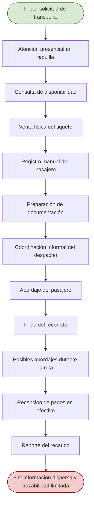
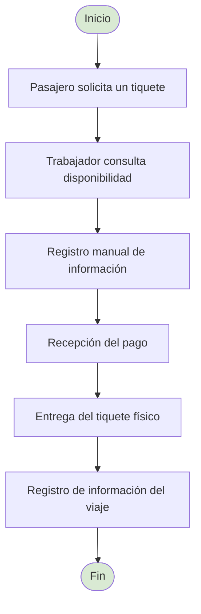
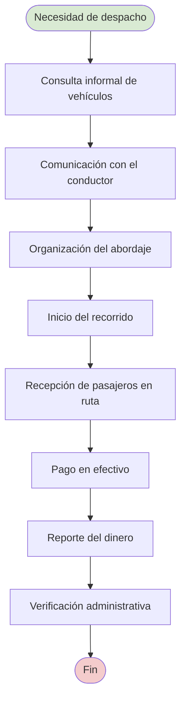
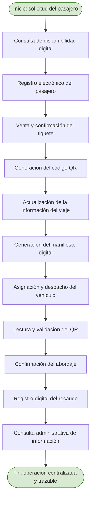
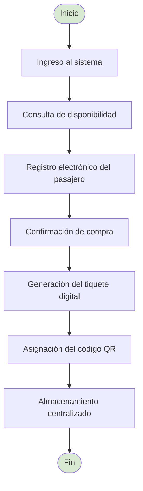
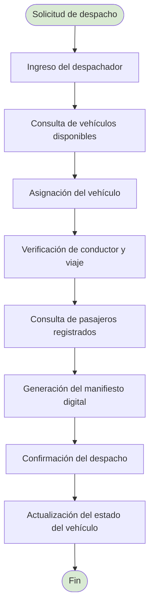
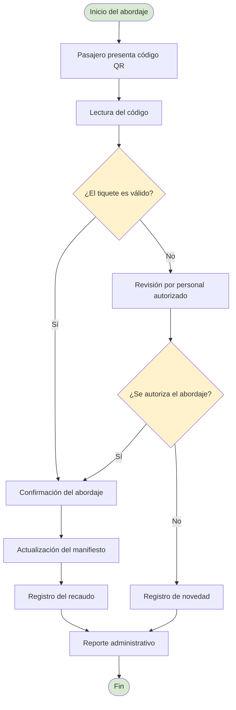

# ARQUITECTURA DE NEGOCIO Y DIAGNÓSTICO EMPRESARIAL
## COOTRANSORIENTE TAYRONA

**Responsable:** Andrea  
**Rol:** Arquitectura de negocio y diagnóstico empresarial  
**Proyecto:** Transformación digital de Cootransoriente Tayrona  
**Proceso principal:** Transporte público intermunicipal  
**Ruta de estudio:** Santa Marta – Palomino, Troncal del Caribe  
**Versión:** 1.0  

---

# 1. CARACTERIZACIÓN DE LA EMPRESA

## 1.1. Nombre y actividad económica

Cootransoriente Tayrona es una cooperativa de transporte público intermunicipal que desarrolla actividades relacionadas con la movilización de pasajeros entre diferentes poblaciones de la región Caribe colombiana. Para este proyecto se analiza principalmente su operación en la ruta Santa Marta–Palomino, ubicada en el departamento del Magdalena y zonas cercanas de La Guajira.

Su actividad económica se encuentra relacionada con la prestación de servicios de transporte terrestre automotor de pasajeros por carretera.

La empresa constituye un actor importante para la movilidad de turistas, estudiantes, trabajadores y habitantes de las comunidades que utilizan esta conexión vial.

## 1.2. Sector económico

La organización pertenece al sector terciario de la economía, específicamente al sector de transporte y servicios.

Este sector cumple una función importante en el desarrollo económico y social porque facilita el desplazamiento de personas, conecta comunidades y contribuye a las actividades comerciales y turísticas.

## 1.3. Ubicación y entorno

El proyecto toma como referencia la operación de transporte entre Santa Marta y Palomino, utilizando principalmente la Troncal del Caribe.

El entorno presenta características particulares:

- Alta circulación de turistas nacionales e internacionales.
- Movilidad constante de trabajadores y estudiantes.
- Incremento de pasajeros durante vacaciones y temporadas turísticas.
- Demanda variable de transporte durante fines de semana y días festivos.
- Necesidad de mantener controles adecuados sobre los pasajeros transportados.
- Importancia de la seguridad vial y del cumplimiento de las disposiciones del transporte público.

## 1.4. Servicios ofrecidos

De acuerdo con el contexto suministrado para el proyecto, los principales servicios relacionados con la operación son:

1. Transporte intermunicipal de pasajeros.
2. Venta de tiquetes en puntos físicos de atención.
3. Asignación y despacho de vehículos.
4. Movilización de pasajeros entre Santa Marta y Palomino.
5. Atención y orientación a los usuarios.
6. Gestión del recaudo correspondiente al servicio de transporte.

Como parte de la transformación digital se propone incorporar canales electrónicos de venta y herramientas digitales para consultar información de los viajes.

## 1.5. Funcionamiento de la ruta Santa Marta–Palomino

La ruta Santa Marta–Palomino conecta dos destinos importantes para la movilidad regional y la actividad turística.

En su funcionamiento intervienen diferentes actores:

- Pasajeros.
- Personal de taquilla.
- Despachadores.
- Conductores.
- Ayudantes.
- Personal administrativo.

La operación requiere coordinar la venta de tiquetes, el registro de los pasajeros, la disponibilidad de vehículos, el despacho y el recaudo del dinero.

Actualmente, según el escenario de referencia del proyecto, estas actividades presentan una dependencia importante de procedimientos manuales, documentos físicos, efectivo y comunicaciones telefónicas.

Esta situación dificulta mantener información centralizada y actualizada sobre los pasajeros y los vehículos que se encuentran en operación.

---

# 2. DIAGNÓSTICO EMPRESARIAL

## 2.1. Situación actual (AS-IS)

La situación AS-IS representa la manera en que funciona actualmente una organización antes de implementar una transformación o mejora de sus procesos.

En Cootransoriente Tayrona se identifica un modelo operativo tradicional en el que diferentes actividades dependen de registros manuales y comunicaciones informales.

Los principales problemas identificados en el contexto del proyecto son:

**1. Procesos manuales y lentos**

La venta de tiquetes se realiza físicamente. El registro de la información de los pasajeros requiere tiempo y puede generar congestión en las taquillas, especialmente durante temporadas de alta demanda.

**2. Ausencia de trazabilidad del recaudo**

Los conductores pueden recoger pasajeros durante el recorrido y recibir pagos en efectivo que no necesariamente quedan registrados de manera inmediata en los controles administrativos de la cooperativa.

Esta situación genera dificultades para verificar los ingresos reales de cada vehículo.

**3. Desconexión de la información**

No existe un mecanismo centralizado que permita conocer en tiempo real la cantidad de vehículos en circulación, la disponibilidad de sillas y el número de pasajeros transportados.

La coordinación depende principalmente de llamadas y comunicaciones informales.

**4. Dificultades en el control de pasajeros**

El manejo de manifiestos y registros físicos puede ocasionar inconsistencias, modificaciones o diferencias entre los pasajeros registrados y los que realmente se transportan.

**5. Limitaciones para planificar la operación**

La ausencia de información consolidada dificulta identificar los horarios de mayor demanda y tomar decisiones oportunas sobre el despacho de vehículos.

## 2.2. Consecuencias del problema

Los problemas identificados pueden generar las siguientes consecuencias:

- Pérdidas económicas por falta de control del recaudo.
- Incremento de los tiempos de atención.
- Demoras en el abordaje de pasajeros.
- Dificultades para verificar la información de los viajeros.
- Falta de información confiable para tomar decisiones.
- Dificultades para supervisar los vehículos en circulación.
- Insatisfacción de los usuarios.
- Mayor exposición a inconsistencias documentales y riesgos de incumplimiento normativo.

## 2.3. Necesidad empresarial

La cooperativa necesita mejorar la administración de sus operaciones mediante un sistema que permita integrar la venta de tiquetes, el registro de pasajeros, el despacho de vehículos y el seguimiento del recaudo.

La solución debe proporcionar información centralizada, reducir la dependencia de documentos físicos y facilitar la consulta de los datos necesarios para administrar los viajes.

---

# 3. MODELO DE NEGOCIO CANVAS

El modelo Canvas permite identificar los principales componentes que intervienen en el funcionamiento de una organización y comprender cómo genera, entrega y captura valor.

La siguiente propuesta se construye a partir del contexto suministrado para el proyecto. Sus componentes deberán validarse con información directa de la cooperativa.

| BLOQUE CANVAS | DESCRIPCIÓN |
|---|---|
| 1. Segmentos de clientes | Turistas nacionales e internacionales, estudiantes, trabajadores, habitantes de Santa Marta, Palomino y comunidades cercanas. |
| 2. Propuesta de valor | Servicio de transporte intermunicipal que facilita la movilidad de pasajeros entre diferentes destinos, buscando ofrecer seguridad, puntualidad, comodidad y facilidad de acceso. |
| 3. Canales | Taquillas físicas, atención presencial y, como propuesta de transformación, portal web y aplicación móvil para consultar y adquirir tiquetes. |
| 4. Relaciones con los clientes | Atención presencial, orientación durante la compra, información sobre horarios y disponibilidad de vehículos, y atención mediante canales digitales. |
| 5. Fuentes de ingresos | Ingresos provenientes de la venta de tiquetes y de la prestación del servicio de transporte de pasajeros. |
| 6. Recursos clave | Vehículos, conductores, ayudantes, personal de taquilla, despachadores, instalaciones, información de pasajeros y recursos tecnológicos. |
| 7. Actividades clave | Venta de tiquetes, registro de pasajeros, despacho de vehículos, transporte, recaudo, control de pasajeros y administración de la operación. |
| 8. Socios clave | Proveedores de vehículos y repuestos, proveedores tecnológicos, proveedores de conectividad, aseguradoras y entidades relacionadas con la regulación y supervisión del transporte. |
| 9. Estructura de costos | Combustible, mantenimiento de vehículos, salarios, seguros, administración, instalaciones, conectividad y posibles inversiones tecnológicas. |

## 3.1. Análisis del modelo Canvas

El modelo Canvas permite observar que el servicio principal de la cooperativa depende de una adecuada coordinación entre los recursos humanos, los vehículos y los procesos administrativos.

La transformación digital puede fortalecer la propuesta de valor mediante una mejor experiencia de compra, mayor organización del despacho y disponibilidad de información confiable.

También puede facilitar el control de los ingresos y mejorar la relación con los pasajeros mediante canales digitales.

---

# 4. LEVANTAMIENTO DE INFORMACIÓN: ENTREVISTAS

El proyecto contempla dos entrevistas obligatorias para conocer directamente el funcionamiento de la organización.

Debido a que no se cuenta actualmente con acceso a las instalaciones ni con autorización para contactar al personal, se presentan los instrumentos de entrevista y sus respectivos formatos de acta.

**Estado de ejecución:** entrevistas diseñadas, pendientes de aplicación.

No se presentan respuestas ficticias ni se atribuyen declaraciones a trabajadores de la cooperativa.

## 4.1. Entrevista 1: administrador o gerente

**Objetivo:** conocer la organización administrativa, los procesos operativos, las dificultades actuales y las necesidades de transformación digital desde la perspectiva de la dirección.

**Perfil del entrevistado:** administrador, gerente o responsable de la cooperativa.

**Preguntas:**

1. ¿Cómo está organizada actualmente la cooperativa?
2. ¿Cuáles son los principales servicios que presta?
3. ¿Cómo funciona actualmente la operación de transporte en la ruta Santa Marta–Palomino?
4. ¿Cómo se realiza la venta de tiquetes?
5. ¿Qué información se solicita a los pasajeros antes de realizar el viaje?
6. ¿Cómo se controla la cantidad de pasajeros que transporta cada vehículo?
7. ¿Cómo se realiza actualmente el despacho de los vehículos?
8. ¿Qué mecanismos utiliza la empresa para controlar los ingresos obtenidos durante los recorridos?
9. ¿Cuáles son las principales dificultades administrativas y operativas?
10. ¿Qué problemas se presentan durante las temporadas de mayor demanda?
11. ¿Cómo se almacena y consulta la información de los pasajeros?
12. ¿Qué mejoras considera prioritarias para modernizar la operación?
13. ¿Qué beneficios espera obtener de un sistema digital de despacho y boletería?

### Formato del acta de entrevista 1

| DATO | INFORMACIÓN |
|---|---|
| Tipo de entrevista | Semiestructurada |
| Cargo del entrevistado | Administrador o gerente |
| Fecha | Pendiente de realización |
| Lugar | Pendiente de confirmación |
| Duración | Pendiente de realización |
| Entrevistador | Andrea |
| Objetivo | Conocer los procesos administrativos y operativos de la cooperativa. |
| Estado | Pendiente de aplicación |

**Desarrollo de la entrevista:**

Este espacio se diligenciará después de realizar la entrevista. Se registrarán las respuestas del entrevistado, los aspectos relevantes identificados y las oportunidades de mejora mencionadas.

**Principales hallazgos:**

Pendientes de validación mediante entrevista.

**Conclusiones:**

Se elaborarán a partir de las respuestas obtenidas y de la información autorizada por el entrevistado.

**Autorización:**

Se solicitará autorización para utilizar la información proporcionada con fines académicos.

---

## 4.2. Entrevista 2: despachador, taquillero o conductor

**Objetivo:** conocer el desarrollo de las actividades operativas, identificar dificultades durante la prestación del servicio y comprender cómo se realizan los procesos de venta, registro, despacho y recaudo.

**Perfil del entrevistado:** despachador, taquillero o conductor.

**Preguntas:**

1. ¿Cuáles son sus principales funciones dentro de la cooperativa?
2. ¿Cómo se realiza actualmente la venta de los tiquetes?
3. ¿Qué procedimiento sigue para registrar la información de los pasajeros?
4. ¿Cómo se verifica la cantidad de pasajeros que pueden abordar un vehículo?
5. ¿Cómo se comunica con el personal encargado del despacho?
6. ¿Qué información recibe antes de iniciar un recorrido?
7. ¿Cómo se controla el ingreso de pasajeros durante el trayecto?
8. ¿Cómo se registra el dinero recibido por concepto de pasajes?
9. ¿Qué dificultades se presentan durante los horarios de mayor movimiento?
10. ¿Qué problemas se generan cuando la información de los pasajeros no está actualizada?
11. ¿Qué herramientas tecnológicas utiliza actualmente para realizar sus funciones?
12. ¿Qué cambios considera necesarios para mejorar el trabajo diario?
13. ¿Considera que una herramienta digital facilitaría sus actividades? ¿Por qué?

### Formato del acta de entrevista 2

| DATO | INFORMACIÓN |
|---|---|
| Tipo de entrevista | Semiestructurada |
| Cargo del entrevistado | Despachador, taquillero o conductor |
| Fecha | Pendiente de realización |
| Lugar | Pendiente de confirmación |
| Duración | Pendiente de realización |
| Entrevistador | Andrea |
| Objetivo | Identificar dificultades de los procesos operativos. |
| Estado | Pendiente de aplicación |

**Desarrollo de la entrevista:**

Se registrarán las respuestas relacionadas con la venta de tiquetes, el registro de pasajeros, la coordinación del despacho, el control durante el recorrido y el recaudo.

**Principales hallazgos:**

Pendientes de validación mediante entrevista.

**Conclusiones:**

Se documentarán después de conocer la experiencia del trabajador entrevistado.

**Autorización:**

Se solicitará autorización para utilizar la información con fines académicos.

---

# 5. OBSERVACIÓN DEL FUNCIONAMIENTO ACTUAL

## 5.1. Objetivo de la observación

Identificar cómo se desarrollan los procesos operativos de Cootransoriente Tayrona y reconocer las dificultades que pueden afectar la atención de los pasajeros, la administración de los vehículos y el control del recaudo.

## 5.2. Aspectos que deben observarse

| ASPECTO | ELEMENTOS POR VERIFICAR |
|---|---|
| Venta de tiquetes | Forma de atención, procedimiento de venta y entrega del tiquete. |
| Registro de pasajeros | Datos solicitados y mecanismo de almacenamiento de la información. |
| Despacho | Asignación de vehículos, comunicación y organización de las salidas. |
| Recaudo | Recepción, registro y verificación del dinero. |
| Control en ruta | Mecanismos para verificar los pasajeros que abordan durante el recorrido. |
| Atención al usuario | Tiempo de atención, orientación y solución de inconvenientes. |
| Documentación | Uso de planillas, tiquetes, manifiestos y otros formatos. |

## 5.3. Instrumento de observación

| N.º | ASPECTO | RESULTADO DE LA OBSERVACIÓN |
|---|---|---|
| 1 | Venta de tiquetes | Pendiente de observación presencial. |
| 2 | Registro de pasajeros | Pendiente de observación presencial. |
| 3 | Despacho de vehículos | Pendiente de observación presencial. |
| 4 | Recaudo del dinero | Pendiente de observación presencial. |
| 5 | Control de pasajeros en ruta | Pendiente de observación presencial. |
| 6 | Manejo de documentos físicos | Pendiente de observación presencial. |
| 7 | Comunicación entre trabajadores | Pendiente de observación presencial. |

## 5.4. Estado de las evidencias

Actualmente no se dispone de fotografías, planillas, tiquetes ni formatos internos autorizados de la cooperativa.

Por esta razón, no se incluyen imágenes que puedan confundirse con documentos reales de la empresa.

Cuando se tenga acceso autorizado, se podrán incorporar:

- Fotografías de tiquetes físicos.
- Fotografías de planillas de registro.
- Ejemplos de formatos de despacho.
- Evidencias de los documentos utilizados.
- Fotografías generales del proceso operativo.

Las fotografías deberán proteger los datos personales de pasajeros y trabajadores.

**Conclusión de la observación:**

La observación presencial constituye una actividad pendiente de validación. El diagnóstico preliminar se fundamenta en el escenario empresarial proporcionado para el proyecto y no debe interpretarse como una visita de campo realizada.

---

# 6. DESCRIPCIÓN DE LOS PROCESOS ACTUALES (AS-IS)

Los procesos AS-IS representan el funcionamiento actual de las actividades de la cooperativa según el contexto del problema.

## 6.1. Proceso de venta de tiquetes

**Descripción:**

El pasajero solicita el servicio de transporte y realiza la compra del tiquete en una taquilla física. El personal encargado registra la operación y entrega el documento correspondiente.

**Actividades:**

1. El pasajero llega al punto de atención.
2. Solicita información sobre el destino y el servicio.
3. El trabajador verifica la disponibilidad según la información disponible.
4. Se realiza la venta del tiquete.
5. Se recibe el pago.
6. Se entrega el tiquete físico.
7. El pasajero continúa con el proceso de abordaje.

**Problemas identificados:**

- Dependencia de la atención presencial.
- Tiempo de atención elevado cuando aumenta la demanda.
- Uso de documentos físicos.
- Dificultades para consultar información consolidada de las ventas.
- Posibles errores durante el registro manual.

## 6.2. Proceso de registro de pasajeros

**Descripción:**

Se registra la información del pasajero necesaria para los procedimientos relacionados con el viaje y la documentación de transporte.

**Actividades:**

1. Se solicita la información del pasajero.
2. El trabajador registra los datos en el formato correspondiente.
3. Se verifica la información disponible.
4. Los datos se utilizan para preparar los registros y documentos del viaje.
5. Se conserva la información mediante los mecanismos actuales.

**Problemas identificados:**

- Diligenciamiento manual.
- Posibilidad de errores de digitación o transcripción.
- Dificultad para actualizar registros.
- Posible duplicación de información.
- Mayor tiempo de atención.
- Riesgo de pérdida o deterioro de documentos físicos.

## 6.3. Proceso de despacho de vehículos

**Descripción:**

El despacho requiere coordinar la disponibilidad de los vehículos, la cantidad de pasajeros y las condiciones de salida.

Según el contexto del proyecto, parte de esta coordinación se realiza mediante llamadas telefónicas y comunicaciones informales.

**Actividades:**

1. Se identifica la necesidad de transportar pasajeros.
2. Se consulta la disponibilidad de vehículos.
3. Se establece comunicación con los conductores.
4. Se organiza la salida del vehículo.
5. Se realiza el abordaje.
6. Se inicia el recorrido.

**Problemas identificados:**

- Información distribuida entre diferentes trabajadores.
- Dificultad para conocer la disponibilidad real de vehículos.
- Dependencia de llamadas telefónicas.
- Falta de actualización centralizada.
- Dificultad para planificar los despachos de acuerdo con la demanda.

## 6.4. Proceso de recaudo del dinero

**Descripción:**

El recaudo se relaciona con la recepción del dinero correspondiente al transporte de pasajeros.

El contexto del proyecto señala que los pagos en efectivo realizados durante el recorrido pueden no quedar registrados oportunamente en los controles administrativos.

**Actividades:**

1. Se realiza la venta del tiquete.
2. El pasajero paga el valor del servicio.
3. El dinero es recibido por el personal encargado.
4. Durante el recorrido pueden presentarse nuevos abordajes y pagos en efectivo.
5. Se realiza el reporte del dinero según los procedimientos disponibles.
6. La administración verifica los ingresos reportados.

**Problemas identificados:**

- Dificultad para verificar todos los pagos recibidos.
- Posibles diferencias entre ingresos reales y reportados.
- Dependencia del efectivo.
- Falta de trazabilidad individual de las transacciones.
- Dificultad para identificar inconsistencias oportunamente.

## 6.5. Proceso de control de pasajeros en ruta

**Descripción:**

Durante el recorrido se requiere controlar la cantidad de pasajeros transportados y verificar que la información registrada corresponda con los viajeros que se encuentran en el vehículo.

**Actividades:**

1. Los pasajeros abordan el vehículo.
2. Se verifica la información disponible.
3. El vehículo inicia el recorrido.
4. Durante el trayecto pueden presentarse nuevos abordajes.
5. Se reciben los pagos correspondientes.
6. Se mantiene el control mediante los mecanismos disponibles.

**Problemas identificados:**

- Falta de actualización inmediata de los pasajeros.
- Dificultad para mantener una trazabilidad completa.
- Posibles diferencias entre el registro y los pasajeros transportados.
- Dependencia de procedimientos manuales.
- Dificultad para consultar la información desde la administración.

---

# 7. DIAGRAMAS DE PROCESOS ACTUALES (AS-IS)

Los siguientes diagramas representan los procesos actuales descritos en el diagnóstico. Están elaborados en Mermaid para que GitHub los convierta automáticamente en diagramas visuales.

## 7.1. Diagrama general del proceso AS-IS

## 7.2. Diagrama AS-IS de venta y registro de pasajeros

## 7.3. Diagrama AS-IS de despacho y recaudo

---

# 8. PROPUESTA DE TRANSFORMACIÓN DE LOS PROCESOS (TO-BE)

## 8.1. Descripción general

La situación TO-BE representa el funcionamiento esperado después de implementar el sistema de despacho y boletería digital.

La propuesta busca integrar los procesos operativos mediante una plataforma que centralice la información de los pasajeros, las ventas, los vehículos y los recaudos.

El sistema deberá permitir que diferentes trabajadores realicen sus actividades desde interfaces adecuadas para sus funciones.

## 8.2. Proceso propuesto de venta de tiquetes

**Descripción:**

Se propone implementar un sistema que permita registrar las ventas desde la taquilla y, posteriormente, habilitar canales digitales para facilitar la adquisición de tiquetes.

**Actividades:**

1. El pasajero solicita el servicio.
2. El trabajador consulta la disponibilidad en el sistema.
3. Se registra la información requerida.
4. Se confirma la compra.
5. El sistema genera el tiquete digital.
6. Se asigna un código QR.
7. La información queda almacenada en la plataforma.

**Beneficios esperados:**

- Reducción de tareas manuales.
- Mayor organización de las ventas.
- Consulta de disponibilidad.
- Disminución de errores de registro.
- Mejor atención al pasajero.

## 8.3. Proceso propuesto de registro de pasajeros

**Descripción:**

Se propone centralizar el registro de los pasajeros en una base de datos que permita consultar y actualizar la información de cada viaje.

**Actividades:**

1. El trabajador ingresa al sistema.
2. Registra los datos del pasajero.
3. El sistema valida los campos obligatorios.
4. La información queda almacenada.
5. Se relaciona el pasajero con el viaje correspondiente.
6. Los datos se utilizan para generar el manifiesto digital.

**Beneficios esperados:**

- Mayor precisión en los registros.
- Consulta centralizada.
- Reducción de duplicidad.
- Disponibilidad de información actualizada.
- Mejor organización documental.

## 8.4. Proceso propuesto de despacho de vehículos

**Descripción:**

Se propone implementar un módulo administrativo que permita consultar la disponibilidad de vehículos, organizar las salidas y actualizar la información de los viajes.

**Actividades:**

1. El despachador ingresa al módulo administrativo.
2. Consulta los vehículos disponibles.
3. Verifica la información del viaje.
4. Asigna el vehículo y el conductor.
5. Confirma los pasajeros registrados.
6. Autoriza el despacho.
7. El sistema actualiza el estado del vehículo.

**Beneficios esperados:**

- Mayor organización de los despachos.
- Información centralizada.
- Mejor coordinación.
- Consulta de disponibilidad.
- Mayor capacidad de planificación.

## 8.5. Proceso propuesto de recaudo

**Descripción:**

Se propone implementar un mecanismo de registro digital de los pagos asociados a cada tiquete y viaje.

**Actividades:**

1. Se registra la venta.
2. Se identifica el viaje relacionado.
3. Se registra el valor recibido.
4. El sistema almacena la transacción.
5. Se generan reportes de recaudo.
6. La administración consulta y verifica los ingresos.

**Beneficios esperados:**

- Mayor trazabilidad del dinero.
- Mejor control de ingresos.
- Identificación de diferencias.
- Disponibilidad de reportes.
- Mayor transparencia en la operación.

## 8.6. Proceso propuesto de control de pasajeros en ruta

**Descripción:**

Se propone utilizar códigos QR para validar los tiquetes y confirmar el abordaje de los pasajeros.

**Actividades:**

1. El pasajero presenta su tiquete digital.
2. El ayudante o trabajador autorizado realiza la lectura del código QR.
3. El sistema verifica la validez del tiquete.
4. Se confirma el abordaje.
5. Se actualiza el registro del pasajero.
6. La información queda disponible para consulta administrativa.

**Beneficios esperados:**

- Mayor control del abordaje.
- Reducción de inconsistencias.
- Consulta de pasajeros registrados.
- Mejor trazabilidad.
- Mayor confiabilidad de los manifiestos.

---

# 9. DIAGRAMAS DE PROCESOS PROPUESTOS (TO-BE)

## 9.1. Diagrama general TO-BE

## 9.2. Diagrama TO-BE de venta y registro de pasajeros

## 9.3. Diagrama TO-BE de despacho

## 9.4. Diagrama TO-BE de control de pasajeros y recaudo

---

# 10. ANÁLISIS COMPARATIVO AS-IS Y TO-BE

El análisis de brechas permite identificar las diferencias entre el funcionamiento actual y el funcionamiento esperado después de la transformación digital.

| PROCESO | SITUACIÓN AS-IS | SITUACIÓN TO-BE | MEJORA ESPERADA |
|---|---|---|---|
| Venta de tiquetes | Venta principalmente física. | Venta registrada en una plataforma digital. | Mayor rapidez y organización. |
| Registro de pasajeros | Registro manual mediante formatos. | Registro electrónico centralizado. | Mayor precisión y disponibilidad. |
| Despacho | Coordinación mediante llamadas y comunicaciones informales. | Módulo centralizado de despacho. | Mejor coordinación y planificación. |
| Recaudo | Manejo de efectivo con trazabilidad limitada. | Registro digital de transacciones. | Mayor control de ingresos. |
| Control en ruta | Verificación mediante mecanismos manuales. | Validación mediante códigos QR. | Mejor control de abordaje. |
| Información administrativa | Información dispersa. | Información centralizada. | Mejor toma de decisiones. |
| Documentación | Uso de registros físicos. | Generación y consulta de documentos digitales. | Mejor organización documental. |

## 10.1. Brechas identificadas

**Brecha 1. Digitalización de las ventas**

La venta física limita la capacidad de atender grandes cantidades de pasajeros en periodos de alta demanda.

**Brecha 2. Centralización de la información**

La información de pasajeros, ventas y viajes necesita integrarse en una plataforma común.

**Brecha 3. Control del recaudo**

La organización requiere mecanismos que permitan relacionar los ingresos con los viajes y los tiquetes vendidos.

**Brecha 4. Control de pasajeros**

Es necesario mejorar la verificación de los pasajeros que realmente abordan cada vehículo.

**Brecha 5. Gestión del despacho**

La falta de información actualizada limita la planificación y coordinación de los vehículos.

---

# 11. DIAGNÓSTICO DE FALLAS Y OPORTUNIDADES DE MEJORA

| N.º | PROBLEMA IDENTIFICADO | CAUSA PRINCIPAL | CONSECUENCIA | OPORTUNIDAD DE MEJORA |
|---|---|---|---|---|
| 1 | Demoras en la venta de tiquetes. | Dependencia de procedimientos manuales. | Congestión y tiempos elevados de atención. | Implementar ventas digitales. |
| 2 | Errores en el registro de pasajeros. | Diligenciamiento manual. | Información incompleta o incorrecta. | Registro electrónico con validaciones. |
| 3 | Dificultad para coordinar vehículos. | Comunicación informal. | Problemas de organización del despacho. | Implementar un módulo de despacho. |
| 4 | Diferencias en el recaudo. | Falta de trazabilidad de los pagos. | Posibles pérdidas económicas. | Registro digital de transacciones. |
| 5 | Dificultad para controlar pasajeros. | Falta de validación centralizada. | Diferencias entre registros y pasajeros transportados. | Utilizar códigos QR. |
| 6 | Información dispersa. | Ausencia de una plataforma integrada. | Dificultad para tomar decisiones. | Centralizar la información. |
| 7 | Riesgo de pérdida documental. | Dependencia de documentos físicos. | Pérdida de registros importantes. | Implementar almacenamiento digital y respaldos. |

## 11.1. Priorización de problemas

Para establecer las prioridades del diagnóstico se consideran tres criterios:

- Impacto operativo: efecto sobre el funcionamiento diario.
- Impacto económico: efecto sobre los ingresos y los costos.
- Impacto en el servicio: efecto sobre la experiencia del pasajero.

| PROBLEMA | IMPACTO OPERATIVO | IMPACTO ECONÓMICO | IMPACTO EN EL SERVICIO | PRIORIDAD |
|---|---|---|---|---|
| Falta de trazabilidad del recaudo | Alto | Alto | Medio | Alta |
| Procesos manuales de venta | Alto | Medio | Alto | Alta |
| Registro manual de pasajeros | Alto | Medio | Alto | Alta |
| Desconexión de información | Alto | Alto | Alto | Alta |
| Control limitado de pasajeros en ruta | Alto | Alto | Alto | Alta |

La clasificación anterior es una valoración cualitativa preliminar basada en el escenario del proyecto. No representa una medición estadística de la empresa.

---

# 12. PROBLEMA EMPRESARIAL PRIORIZADO

## 12.1. Definición del problema

El problema empresarial priorizado es la falta de integración y trazabilidad de los procesos operativos de Cootransoriente Tayrona, especialmente en la venta de tiquetes, el registro de pasajeros, el despacho de vehículos y el recaudo del dinero.

La dependencia de procedimientos manuales, documentos físicos y comunicaciones informales dificulta mantener información confiable y actualizada sobre la operación del transporte.

Esta situación puede ocasionar demoras en la atención, inconsistencias en los registros, dificultades para controlar los ingresos y limitaciones para tomar decisiones administrativas.

## 12.2. Justificación de la prioridad

Se considera prioritario porque afecta diferentes actividades de la cooperativa y no solamente un procedimiento individual.

La falta de trazabilidad del recaudo puede afectar directamente los ingresos de la organización, mientras que la ausencia de información centralizada dificulta verificar los pasajeros, planificar los despachos y controlar la operación.

Por esta razón, se propone abordar el problema mediante un sistema integrado de despacho y boletería digital.

## 12.3. Objetivo de mejora

Proponer la transformación de los procesos de venta, registro, despacho, recaudo y control de pasajeros mediante una plataforma digital que centralice la información, facilite la gestión operativa y fortalezca la trazabilidad de las actividades de transporte.

---

# 13. INDICADORES DE GESTIÓN Y LÍNEA BASE

Los indicadores permiten medir el comportamiento de los procesos y evaluar los resultados obtenidos después de implementar mejoras.

Para este proyecto se proponen indicadores que permitan comparar el funcionamiento actual con el funcionamiento esperado.

**Importante:** no se cuenta con acceso a registros históricos de la cooperativa. Por lo tanto, no es posible establecer valores numéricos reales de línea base. Los campos siguientes quedan preparados para diligenciarse cuando se obtenga información autorizada.

## 13.1. Indicadores propuestos

| INDICADOR | FÓRMULA | UNIDAD | PROPÓSITO |
|---|---|---|---|
| Tiempo promedio de venta | Tiempo total de atención / Número de ventas | Minutos | Medir la rapidez de atención. |
| Porcentaje de registros completos | Registros completos / Total de registros × 100 | Porcentaje | Medir la calidad de los datos. |
| Porcentaje de viajes con manifiesto completo | Viajes con manifiesto completo / Total de viajes × 100 | Porcentaje | Evaluar la documentación de los viajes. |
| Diferencia de recaudo | Recaudo esperado - Recaudo reportado | Pesos colombianos | Identificar diferencias económicas. |
| Porcentaje de pasajeros validados | Pasajeros validados / Total de pasajeros registrados × 100 | Porcentaje | Medir el control de abordaje. |
| Tiempo promedio de despacho | Tiempo total de despacho / Número de despachos | Minutos | Evaluar la eficiencia operativa. |
| Porcentaje de viajes con información completa | Viajes con información completa / Total de viajes × 100 | Porcentaje | Medir la disponibilidad de información. |

## 13.2. Línea base

| INDICADOR | SITUACIÓN ACTUAL CONOCIDA | VALOR NUMÉRICO DE LÍNEA BASE |
|---|---|---|
| Tiempo promedio de venta | Se reportan demoras por procedimientos manuales. | Pendiente de medición. |
| Registros completos de pasajeros | Se identifican riesgos de errores manuales. | Pendiente de medición. |
| Manifiestos completos | Se reporta riesgo de inconsistencias documentales. | Pendiente de medición. |
| Diferencia de recaudo | Se identifica un problema de trazabilidad. | Pendiente de medición. |
| Pasajeros validados | No se dispone de una medición consolidada. | Pendiente de medición. |
| Tiempo de despacho | Se reporta dependencia de comunicaciones informales. | Pendiente de medición. |
| Información completa de los viajes | Se identifica información dispersa. | Pendiente de medición. |

## 13.3. Procedimiento para establecer la línea base real

Cuando se tenga acceso autorizado a la información de la cooperativa, se recomienda:

1. Seleccionar una muestra de viajes realizados.
2. Registrar los tiempos de atención en taquilla.
3. Revisar los formatos de registro de pasajeros.
4. Comparar los manifiestos con la información disponible.
5. Consultar los registros de recaudo.
6. Identificar diferencias entre los ingresos registrados y los reportados.
7. Calcular los indicadores mediante las fórmulas establecidas.
8. Registrar los resultados en una tabla de seguimiento.

Se recomienda medir los indicadores durante un periodo representativo que incluya días de demanda normal y días de alta demanda.

## 13.4. Metas propuestas

Las siguientes metas son objetivos sugeridos para evaluar el sistema después de su implementación. No son resultados alcanzados ni compromisos aprobados por la cooperativa.

| INDICADOR | META PROPUESTA |
|---|---|
| Tiempo promedio de venta | Reducir el tiempo de atención respecto a la línea base. |
| Registros completos de pasajeros | Alcanzar al menos el 98 %. |
| Manifiestos completos | Alcanzar el 100 % de los viajes registrados. |
| Diferencia de recaudo | Reducir las diferencias no justificadas. |
| Pasajeros validados | Alcanzar al menos el 98 % de los pasajeros registrados. |
| Tiempo de despacho | Reducir los tiempos respecto a la línea base. |
| Información completa de los viajes | Alcanzar al menos el 98 %. |

Las metas deberán ajustarse después de conocer las condiciones reales de operación y los resultados de las mediciones iniciales.

---

# 14. PROPUESTA DE MEJORA DESDE LA ARQUITECTURA DE NEGOCIO

A partir del diagnóstico se propone transformar los procesos mediante una plataforma integrada de despacho y boletería digital.

La solución se plantea como una respuesta a las necesidades empresariales identificadas.

## 14.1. Componentes funcionales propuestos

| COMPONENTE | FUNCIÓN DENTRO DEL NEGOCIO |
|---|---|
| Módulo de venta | Registrar y consultar las ventas de tiquetes. |
| Registro de pasajeros | Almacenar la información requerida para cada viaje. |
| Gestión de viajes | Organizar horarios, destinos y disponibilidad. |
| Módulo de despacho | Coordinar vehículos y conductores. |
| Manifiesto digital | Consolidar la información de pasajeros por viaje. |
| Código QR | Facilitar la validación de los tiquetes y el abordaje. |
| Control de recaudo | Registrar y consultar los ingresos de cada operación. |
| Reportes administrativos | Facilitar el análisis de la operación. |

## 14.2. Beneficios empresariales esperados

**Beneficios operativos**

- Mayor organización de los procesos.
- Reducción de tareas manuales.
- Mejor coordinación de los despachos.
- Mayor rapidez en el registro de pasajeros.
- Consulta centralizada de la información.

**Beneficios económicos**

- Mayor trazabilidad de los ingresos.
- Reducción de inconsistencias en el recaudo.
- Mejor control de las ventas.
- Disponibilidad de reportes para la administración.

**Beneficios para los pasajeros**

- Mayor facilidad para adquirir tiquetes.
- Menores tiempos de espera.
- Mejor organización del abordaje.
- Mayor confiabilidad de la información del viaje.

**Beneficios administrativos**

- Acceso a información organizada.
- Mejor seguimiento de los vehículos.
- Facilidad para consultar los registros.
- Mayor capacidad para tomar decisiones.

---

# 15. RELACIÓN DE LOS ENTREGABLES DE ANDREA CON EL PROYECTO

La siguiente tabla permite verificar el cumplimiento de las actividades asignadas al rol de arquitectura de negocio y diagnóstico empresarial.

| N.º | ACTIVIDAD ASIGNADA | DESARROLLO EN ESTE DOCUMENTO | ESTADO |
|---|---|---|---|
| 1 | Caracterización de la empresa | Sección 1 | Desarrollado con contexto disponible. |
| 2 | Entrevista al administrador o gerente | Sección 4.1 | Guion elaborado; entrevista pendiente. |
| 3 | Entrevista a despachador, taquillero o conductor | Sección 4.2 | Guion elaborado; entrevista pendiente. |
| 4 | Actas de entrevistas | Sección 4 | Formatos preparados; pendientes de diligenciar. |
| 5 | Observación del funcionamiento actual | Sección 5 | Instrumento elaborado; observación pendiente. |
| 6 | Fotografías y evidencias | Sección 5.4 | Pendientes de acceso y autorización. |
| 7 | Modelo de negocio Canvas | Sección 3 | Desarrollado de forma preliminar. |
| 8 | Descripción de procesos AS-IS | Sección 6 | Desarrollado. |
| 9 | Identificación de fallas | Secciones 2 y 11 | Desarrollado. |
| 10 | Diagramas AS-IS y TO-BE | Secciones 7 y 9 | Elaborados en Mermaid. |
| 11 | Línea base de indicadores | Sección 13 | Indicadores y metodología elaborados; cifras reales pendientes. |
| 12 | Diagnóstico empresarial | Secciones 2, 10, 11 y 12 | Desarrollado. |
| 13 | Problema priorizado | Sección 12 | Desarrollado. |

---

# 16. CONCLUSIONES

El diagnóstico empresarial de Cootransoriente Tayrona permite identificar la necesidad de mejorar la integración de sus procesos operativos, especialmente aquellos relacionados con la venta de tiquetes, el registro de pasajeros, el despacho de vehículos, el recaudo y el control durante los recorridos.

La dependencia de procedimientos manuales y comunicaciones informales representa una limitación para mantener información centralizada y realizar un seguimiento adecuado de las actividades de transporte.

El modelo Canvas permite reconocer los elementos principales del negocio y comprender la importancia de coordinar los recursos humanos, los vehículos, los canales de atención y las actividades operativas.

La comparación entre los procesos AS-IS y TO-BE evidencia oportunidades de mejora mediante la incorporación de herramientas digitales que faciliten la gestión de los viajes y permitan fortalecer la trazabilidad de la operación.

La propuesta de transformación digital busca mejorar la eficiencia administrativa, reducir las inconsistencias de información y ofrecer una experiencia más organizada a los pasajeros.

Finalmente, se considera que la implementación de una plataforma integrada de despacho y boletería digital puede contribuir al fortalecimiento empresarial de Cootransoriente Tayrona, siempre que su diseño e implementación respondan a las necesidades reales de la cooperativa y se acompañen de una adecuada validación de los procesos.

---

# 17. REFERENCIAS BIBLIOGRÁFICAS

Osterwalder, A., & Pigneur, Y. (2010). *Business model generation: A handbook for visionaries, game changers, and challengers*. John Wiley & Sons.

Project Management Institute. (2021). *A guide to the project management body of knowledge (PMBOK guide)* (7th ed.). Project Management Institute.

Object Management Group. (2014). *Business Process Model and Notation (BPMN), Version 2.0.2*. https://www.omg.org/spec/BPMN/2.0.2/

GitHub. (s. f.). *Creating diagrams*. GitHub Docs. https://docs.github.com/en/get-started/writing-on-github/working-with-advanced-formatting/creating-diagrams

---

# 18. NOTA METODOLÓGICA Y ALCANCE DEL DOCUMENTO

Este documento desarrolla exclusivamente el rol de Andrea: arquitectura de negocio y diagnóstico empresarial.

La información empresarial utilizada como punto de partida corresponde al contexto de Cootransoriente Tayrona suministrado para el proyecto académico.

Es importante distinguir entre los elementos desarrollados como propuesta y los datos que requieren validación directa.

**Información desarrollada:**

- Caracterización preliminar.
- Diagnóstico del escenario empresarial.
- Modelo Canvas propuesto.
- Descripción de procesos AS-IS.
- Diseño de procesos TO-BE.
- Diagramas de procesos.
- Identificación de fallas.
- Análisis de brechas.
- Problema priorizado.
- Indicadores y fórmulas de medición.
- Propuesta de mejora.

