# ANDREA – ARQUITECTURA DE NEGOCIO Y DIAGNÓSTICO EMPRESARIAL
## COOTRANSORIENTE TAYRONA

**Responsable:** Andrea  
**Rol:** Arquitectura de negocio y diagnóstico empresarial  
**Proyecto:** Transformación digital de Cootransoriente Tayrona  
**Proceso principal:** Transporte público intermunicipal en la ruta Santa Marta–Palomino.

---

# 1. CARACTERIZACIÓN DE LA EMPRESA

## 1.1. Identificación empresarial

Cootransoriente Tayrona es una cooperativa de transporte público intermunicipal que desarrolla sus actividades principalmente en la ruta Santa Marta–Palomino, utilizando la Troncal del Caribe como corredor de movilidad.

Su actividad se relaciona con la prestación de servicios de transporte terrestre de pasajeros, atendiendo las necesidades de movilidad de turistas nacionales e internacionales, trabajadores de la región, estudiantes y demás personas que requieren desplazarse entre los municipios y localidades del corredor.

La operación de la cooperativa requiere coordinar la venta de tiquetes, el registro de pasajeros, la asignación de vehículos, el despacho de los recorridos, el control de los pasajeros y la administración de los ingresos generados por el servicio.

**Nota de caracterización:** La información anterior se fundamenta en el contexto empresarial suministrado para el proyecto académico y en los datos recopilados durante las entrevistas virtuales del 11 de noviembre de 2026. Durante dichas conversaciones se mencionó que la cooperativa cuenta con 52 vehículos y 52 trabajadores que disponen de un dispositivo. Sin embargo, no se cuenta con documentación institucional para verificar estas cifras, por lo que se presentan como datos reportados durante las entrevistas y pendientes de confirmación documental. La razón social completa, el NIT, la dirección administrativa y la estructura organizacional también deberán confirmarse con la organización.

## 1.2. Actividad económica

La actividad económica principal de la organización corresponde a la prestación del servicio de transporte terrestre público de pasajeros en modalidad intermunicipal.

Esta actividad implica desarrollar procesos administrativos y operativos que permitan garantizar la atención de los pasajeros, la disponibilidad de vehículos, la organización de los recorridos y el cumplimiento de los requisitos aplicables al transporte.

## 1.3. Sector económico

La cooperativa pertenece al sector terciario de la economía, específicamente al sector de transporte y servicios de movilidad.

Este sector cumple una función importante en la conexión de comunidades, el desplazamiento de trabajadores y estudiantes y el desarrollo de actividades turísticas y comerciales.

## 1.4. Ubicación y entorno

El escenario de operación analizado corresponde al corredor vial Santa Marta–Palomino, en la Troncal del Caribe.

Este corredor presenta movimiento de pasajeros asociado a diferentes actividades:

- Turismo nacional e internacional.
- Desplazamiento de trabajadores.
- Movilidad de estudiantes.
- Actividades comerciales.
- Conexión entre localidades de la región.

La demanda puede variar de acuerdo con las temporadas turísticas, vacaciones, fines de semana y puentes festivos. Estas variaciones hacen necesario contar con mecanismos adecuados para planificar los despachos y controlar la disponibilidad de los vehículos.

## 1.5. Servicios ofrecidos

De acuerdo con el contexto del proyecto, el servicio principal es el transporte público intermunicipal de pasajeros.

Para prestar este servicio se desarrollan actividades relacionadas con:

- Venta de tiquetes.
- Atención al pasajero.
- Registro de información de los viajeros.
- Asignación de puestos.
- Organización de los vehículos.
- Despacho de recorridos.
- Control de pasajeros.
- Recaudo de los valores correspondientes al servicio.

No se dispone de un catálogo institucional de servicios adicionales, por lo que no se atribuyen otros servicios comerciales a la cooperativa.

## 1.6. Funcionamiento de la ruta Santa Marta–Palomino

La ruta Santa Marta–Palomino constituye el escenario operativo principal del proyecto.

El funcionamiento del servicio requiere que los pasajeros puedan adquirir sus tiquetes, registrar sus datos y abordar los vehículos correspondientes.

En el modelo descrito para el caso empresarial, la operación se desarrolla mediante procedimientos tradicionales que incluyen el uso de tiquetes físicos, registros manuales, coordinación mediante llamadas y comunicación informal entre el personal de despacho y los conductores.

Durante los recorridos también pueden presentarse situaciones relacionadas con el abordaje de pasajeros en diferentes puntos de la vía y el manejo de pagos en efectivo.

Estas condiciones generan la necesidad de mejorar la coordinación operativa y fortalecer la trazabilidad de la información.

## 1.7. Importancia del proceso de negocio

El transporte intermunicipal requiere una relación coordinada entre diferentes actividades:

1. Atención y venta de tiquetes.
2. Registro de pasajeros.
3. Organización de los viajes.
4. Asignación de vehículos.
5. Despacho de los recorridos.
6. Control de pasajeros durante el viaje.
7. Registro y verificación del recaudo.

Cuando estas actividades no comparten información actualizada, pueden producirse errores, demoras y dificultades para controlar la operación.

Por esta razón, el diagnóstico se concentra en identificar las debilidades de los procesos actuales y establecer oportunidades de mejora mediante la transformación digital.

---

# 2. DIAGNÓSTICO EMPRESARIAL

## 2.1. Situación actual de la organización (AS-IS)

La situación actual de Cootransoriente Tayrona, de acuerdo con el escenario proporcionado, se caracteriza por la utilización de procedimientos manuales y mecanismos de comunicación poco integrados.

La venta de tiquetes se realiza en formato físico y el registro de información de los pasajeros requiere diligenciamiento manual. Esta situación puede aumentar los tiempos de atención, especialmente cuando se incrementa la demanda.

En el proceso de despacho, la información sobre los vehículos disponibles, la cantidad de pasajeros y las condiciones de los recorridos se coordina principalmente mediante llamadas telefónicas y comunicación informal.

Por otra parte, el manejo del recaudo presenta dificultades de trazabilidad debido al uso de efectivo y a la posibilidad de que se reciban pagos durante el recorrido que no queden registrados de manera centralizada.

También existe una dificultad para conocer en tiempo real la cantidad de pasajeros transportados, las sillas disponibles y el estado de los vehículos.

Finalmente, el manejo de manifiestos físicos puede generar inconsistencias cuando la información no se encuentra actualizada.

## 2.2. Principales problemas identificados

| Problema | Descripción | Consecuencia empresarial |
|---|---|---|
| Venta manual de tiquetes | Utilización de tiquetes físicos. | Demoras en la atención y dificultad para consolidar ventas. |
| Registro manual de pasajeros | Diligenciamiento físico de información. | Posibilidad de errores y duplicidad de datos. |
| Despacho desorganizado | Coordinación mediante llamadas y comunicación informal. | Dificultad para conocer la disponibilidad de vehículos. |
| Falta de trazabilidad del recaudo | Manejo de efectivo sin registro centralizado de todas las operaciones. | Diferencias entre ingresos recibidos e ingresos reportados. |
| Control limitado en ruta | Dificultad para verificar todos los pasajeros transportados. | Inconsistencias en los registros del viaje. |
| Información dispersa | Los datos no se encuentran integrados en un único sistema. | Dificultad para tomar decisiones oportunas. |
| Riesgo documental | Manifiestos físicos susceptibles a errores o desactualización. | Posibles incumplimientos y dificultades de verificación. |

## 2.3. Causas del problema

Las principales causas identificadas en el escenario son:

- Dependencia de documentos físicos.
- Falta de una plataforma centralizada.
- Comunicación informal entre los trabajadores.
- Ausencia de mecanismos integrados de consulta de disponibilidad.
- Registro no centralizado de los pagos recibidos durante los recorridos.
- Actualización manual de la información de los pasajeros.
- Limitaciones para consolidar los datos de la operación.

## 2.4. Consecuencias del problema

Las situaciones anteriores pueden generar:

- Incremento de los tiempos de atención.
- Dificultades en temporadas de alta demanda.
- Errores en los registros de pasajeros.
- Diferencias en los reportes de recaudo.
- Dificultad para planificar los despachos.
- Menor capacidad de seguimiento de los recorridos.
- Riesgos asociados a la documentación de los pasajeros.
- Limitaciones para obtener información confiable de la operación.

## 2.5. Necesidad empresarial identificada

La cooperativa necesita mejorar la integración de sus procesos operativos y administrativos mediante mecanismos que permitan centralizar la información y facilitar su consulta.

La necesidad principal consiste en fortalecer la trazabilidad de los pasajeros, los tiquetes, los vehículos y los ingresos, de manera que la información utilizada para administrar el servicio sea organizada, actualizada y verificable.

---

# 3. MODELO DE NEGOCIO CANVAS

## 3.1. Descripción general

El modelo Canvas permite representar los componentes fundamentales del funcionamiento de una organización mediante nueve bloques relacionados entre sí.

Para Cootransoriente Tayrona, este modelo permite identificar los clientes, la propuesta de valor, los canales de atención, las actividades necesarias para prestar el servicio y los recursos que intervienen en la operación.

El siguiente Canvas es una caracterización preliminar construida a partir del contexto del caso y de la información recopilada en las entrevistas virtuales realizadas el 11 de noviembre de 2026. Sus elementos se han contrastado parcialmente con los comentarios del personal entrevistado; no obstante, deben seguir validándose con información institucional y documentación de la cooperativa.

## 3.2. Los nueve bloques del modelo Canvas

### 1. Segmentos de clientes

Los principales segmentos de clientes identificados son:

- Turistas nacionales que necesitan desplazarse por el corredor Santa Marta–Palomino.
- Turistas internacionales que visitan la región.
- Trabajadores que utilizan el transporte para movilizarse.
- Estudiantes que requieren desplazamiento entre localidades.
- Habitantes de las zonas atendidas por el servicio.
- Personas que necesitan realizar viajes intermunicipales.

### 2. Propuesta de valor

La propuesta de valor se relaciona con ofrecer un servicio de transporte intermunicipal que facilite la movilidad de los pasajeros entre Santa Marta y Palomino.

La transformación digital busca fortalecer esta propuesta mediante:

- Mayor organización en la venta de tiquetes.
- Mejor control de los pasajeros.
- Mayor agilidad en el proceso de abordaje.
- Información más confiable sobre los viajes.
- Mejor coordinación de los vehículos.
- Mayor trazabilidad de las operaciones.

### 3. Canales

Los canales identificados o propuestos son:

- Taquilla física.
- Atención directa al pasajero.
- Venta de tiquetes mediante portal web.
- Aplicación o interfaz móvil para los trabajadores.
- Comunicación con el personal de la cooperativa.

Los canales digitales corresponden a propuestas del proyecto y no deben interpretarse como servicios que actualmente estén implementados.

### 4. Relaciones con los clientes

La relación con los clientes se desarrolla principalmente mediante la atención durante la compra del tiquete, la orientación sobre el servicio y la asistencia durante el abordaje.

Se propone fortalecer esta relación mediante:

- Información clara sobre los viajes.
- Confirmación de la compra.
- Emisión de tiquetes digitales.
- Validación del código QR.
- Atención organizada de solicitudes.
- Mayor facilidad para consultar la información del viaje.

### 5. Fuentes de ingresos

La principal fuente de ingresos identificada es el cobro de los pasajes por el servicio de transporte de pasajeros.

El proyecto busca mejorar el control y la trazabilidad de estos ingresos mediante el registro de las operaciones de venta y de los pagos realizados durante los recorridos.

No se cuenta con información financiera real para determinar los valores recaudados, tarifas, porcentajes de participación o ingresos mensuales.

### 6. Recursos clave

Los recursos necesarios para el funcionamiento del servicio incluyen:

- Vehículos destinados al transporte de pasajeros.
- Conductores.
- Personal de taquilla.
- Despachadores.
- Ayudantes.
- Instalaciones y puntos de atención.
- Documentación operativa.
- Información de pasajeros y viajes.
- Sistemas de comunicación.

Como recursos futuros para la transformación digital se proponen dispositivos móviles, una plataforma de gestión y una base de datos centralizada.

### 7. Actividades clave

Las principales actividades del negocio son:

- Atención a los pasajeros.
- Venta de tiquetes.
- Registro de información.
- Organización de los recorridos.
- Asignación de vehículos.
- Despacho de unidades.
- Control de pasajeros durante la ruta.
- Recaudo de los pagos.
- Elaboración y gestión de manifiestos.
- Seguimiento administrativo de la operación.

### 8. Socios clave

Los actores que intervienen o pueden relacionarse con la operación son:

- Personal administrativo.
- Conductores.
- Ayudantes.
- Personal de taquilla.
- Proveedores de vehículos y mantenimiento.
- Proveedores de servicios tecnológicos.
- Entidades de supervisión del transporte.
- Autoridades relacionadas con la seguridad vial.

La identificación de socios comerciales específicos deberá confirmarse con la cooperativa.

### 9. Estructura de costos

Los costos asociados al funcionamiento del negocio pueden incluir:

- Operación y mantenimiento de vehículos.
- Combustible.
- Pago del personal.
- Administración.
- Seguros y obligaciones relacionadas con la operación.
- Mantenimiento de instalaciones.
- Documentación y gestión operativa.

Para la transformación digital se contemplan posibles costos adicionales relacionados con:

- Desarrollo o adquisición de software.
- Equipos móviles.
- Conectividad.
- Alojamiento en la nube.
- Soporte técnico.
- Mantenimiento de la plataforma.

Los valores económicos y las cotizaciones serán desarrollados por el responsable de finanzas del proyecto.

## 3.3. Resumen del Canvas

| Bloque | Descripción |
|---|---|
| Segmentos de clientes | Turistas, trabajadores, estudiantes y habitantes de las zonas atendidas. |
| Propuesta de valor | Transporte intermunicipal entre Santa Marta y Palomino. |
| Canales | Taquilla y canales digitales propuestos. |
| Relaciones con clientes | Atención, orientación y asistencia durante el servicio. |
| Fuentes de ingresos | Venta de pasajes. |
| Recursos clave | Vehículos, conductores, personal, instalaciones e información. |
| Actividades clave | Venta, registro, despacho, transporte y recaudo. |
| Socios clave | Personal, proveedores y actores institucionales relacionados. |
| Estructura de costos | Operación, mantenimiento, personal y recursos tecnológicos. |

---

# 4. DESCRIPCIÓN DE LOS PROCESOS ACTUALES (AS-IS)

## 4.1. Concepto

El modelo AS-IS representa la manera en que una organización desarrolla sus actividades actualmente.

En este proyecto permite identificar cómo se realizan los procesos de venta de tiquetes, registro de pasajeros, despacho de vehículos, recaudo y control durante los recorridos.

Los siguientes procesos se describen de acuerdo con el contexto empresarial suministrado y la información recopilada en las entrevistas. No corresponden a una observación presencial realizada por la estudiante.

## 4.2. Proceso de venta de tiquetes AS-IS

**Objetivo:** permitir que los pasajeros adquieran un tiquete para realizar el recorrido correspondiente.

**Descripción del proceso:**

1. El pasajero llega al punto de atención.
2. Solicita información sobre el servicio.
3. El trabajador consulta la disponibilidad mediante los mecanismos utilizados actualmente.
4. Se informa al pasajero sobre el viaje.
5. Se recibe el pago correspondiente.
6. Se entrega el tiquete físico.
7. La información de la venta se registra mediante los procedimientos manuales existentes.

**Problemas identificados:**

- Dependencia de documentos físicos.
- Demoras durante la atención.
- Dificultad para consultar la disponibilidad actualizada.
- Posibilidad de errores en el registro.
- Dificultad para consolidar las ventas.

### Diagrama de venta AS-IS

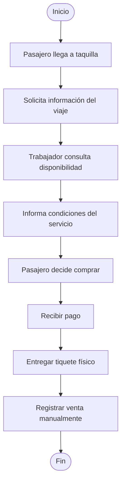

## 4.3. Proceso de registro de pasajeros AS-IS

**Objetivo:** recopilar la información de los pasajeros requerida para la operación del servicio y la documentación correspondiente.

**Descripción del proceso:**

1. El pasajero solicita el servicio.
2. El trabajador solicita los datos necesarios.
3. El pasajero proporciona su información.
4. El trabajador diligencia los datos en el formato correspondiente.
5. Se verifica la información de manera manual.
6. Los registros se utilizan para la documentación del viaje.
7. Los formatos quedan sujetos a los procedimientos físicos de almacenamiento y consulta.

**Problemas identificados:**

- Mayor tiempo de diligenciamiento.
- Posibilidad de errores de transcripción.
- Dificultad para actualizar los registros.
- Dependencia de documentos físicos.
- Dificultad para consultar información de forma inmediata.

### Diagrama de registro AS-IS

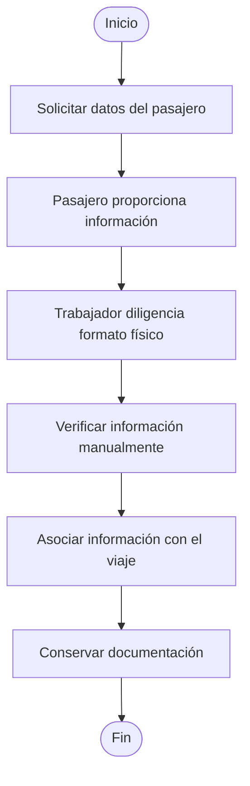

## 4.4. Proceso de despacho de vehículos AS-IS

**Objetivo:** organizar la salida de los vehículos para prestar el servicio de transporte.

**Descripción del proceso:**

1. Se identifica la necesidad de realizar un recorrido.
2. El despachador consulta la disponibilidad mediante los mecanismos actuales.
3. Se establece comunicación con los conductores.
4. Se coordina la asignación de vehículos.
5. Se verifica la información disponible de los pasajeros.
6. Se organizan los documentos correspondientes.
7. Se autoriza la salida del vehículo según el procedimiento operativo.

**Problemas identificados:**

- Comunicación informal.
- Información dispersa.
- Dificultad para conocer la disponibilidad de los vehículos.
- Limitaciones para consultar los pasajeros registrados.
- Falta de información centralizada sobre los despachos.

### Diagrama de despacho AS-IS

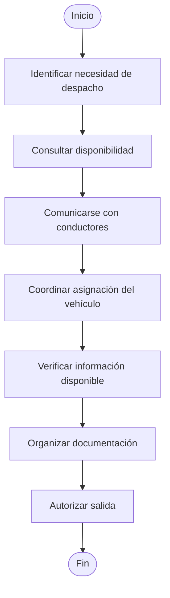

## 4.5. Proceso de recaudo AS-IS

**Objetivo:** recibir y controlar los ingresos generados por el transporte de pasajeros.

**Descripción del proceso:**

1. El pasajero realiza el pago del servicio.
2. El trabajador recibe el dinero.
3. Se entrega el tiquete o se confirma el pago según el procedimiento utilizado.
4. Durante el recorrido pueden presentarse pagos adicionales por pasajeros que abordan en la vía.
5. El dinero recibido durante el servicio queda sujeto al reporte y entrega correspondiente.
6. La cooperativa consolida los ingresos reportados.
7. Se presentan dificultades para verificar la totalidad de las operaciones realizadas durante el recorrido.

**Problemas identificados:**

- Dependencia del manejo de efectivo.
- Dificultad para verificar todos los pagos.
- Posibles diferencias entre ingresos recibidos y reportados.
- Falta de trazabilidad centralizada.
- Limitaciones para realizar conciliaciones oportunas.

### Diagrama de recaudo AS-IS

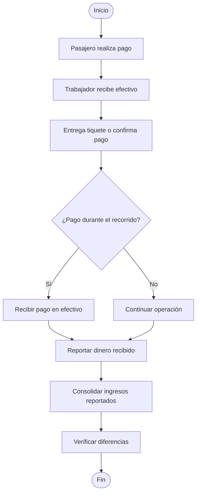

## 4.6. Proceso de control de pasajeros en ruta AS-IS

**Objetivo:** controlar la cantidad de pasajeros transportados durante los recorridos.

**Descripción del proceso:**

1. El vehículo inicia el recorrido.
2. Los pasajeros abordan según el procedimiento utilizado.
3. Se verifica la documentación o el tiquete disponible.
4. Durante el trayecto pueden presentarse nuevos abordajes.
5. Los pagos correspondientes pueden realizarse en efectivo.
6. La información de los pasajeros queda sujeta a los mecanismos de registro y reporte existentes.
7. Se presentan dificultades para mantener una consulta centralizada y actualizada del total de pasajeros.

**Problemas identificados:**

- Falta de actualización inmediata de los registros.
- Dificultad para conocer el número exacto de pasajeros.
- Limitaciones para verificar todos los abordajes.
- Riesgo de diferencias en los manifiestos.
- Falta de integración entre la operación en ruta y la administración.

### Diagrama de control de pasajeros AS-IS

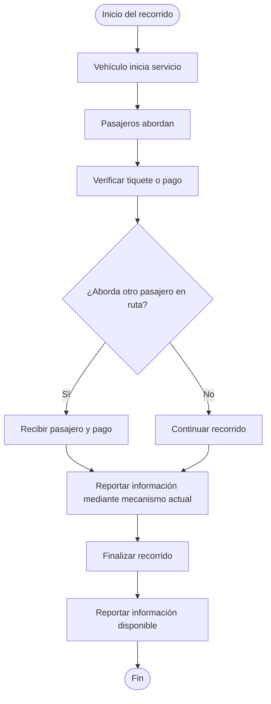

## 4.7. Resumen de los procesos AS-IS

| Proceso | Actividad principal | Dificultad identificada |
|---|---|---|
| Venta de tiquetes | Venta y entrega de tiquetes físicos. | Demoras y dependencia del papel. |
| Registro de pasajeros | Diligenciamiento de formatos. | Errores y dificultad de consulta. |
| Despacho | Coordinación de vehículos. | Comunicación informal. |
| Recaudo | Recepción y reporte de dinero. | Falta de trazabilidad. |
| Control en ruta | Verificación de pasajeros. | Información desactualizada. |

---

# 5. PROCESOS PROPUESTOS (TO-BE)

## 5.1. Objetivo del modelo TO-BE

El modelo TO-BE representa la situación futura que se espera alcanzar mediante la transformación digital de Cootransoriente Tayrona.

Se propone implementar un sistema integrado de despacho y boletería digital que permita centralizar la información de pasajeros, tiquetes, vehículos y recaudos.

La solución busca reducir la dependencia de documentos físicos, mejorar la coordinación entre trabajadores y facilitar el seguimiento de las operaciones.

## 5.2. Proceso propuesto de venta digital de tiquetes

**Objetivo:** agilizar la compra de tiquetes y registrar digitalmente cada operación.

**Funcionamiento propuesto:**

1. El pasajero solicita el servicio en taquilla o mediante un canal digital habilitado.
2. El trabajador consulta los horarios y la disponibilidad en el sistema.
3. Se selecciona el vehículo y el asiento disponible.
4. Se registran los datos del pasajero.
5. El sistema valida la información.
6. Se registra el pago.
7. Se genera un tiquete digital con código QR.
8. La información queda almacenada en la base de datos.
9. El pasajero presenta su código QR para abordar.

**Beneficios esperados:**

- Reducción del tiempo de atención.
- Menor utilización de papel.
- Información centralizada.
- Consulta de disponibilidad.
- Mayor facilidad para verificar los tiquetes.

### Diagrama de venta TO-BE

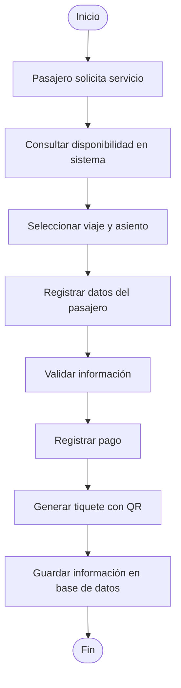

## 5.3. Proceso propuesto de registro de pasajeros

**Objetivo:** mantener un registro digital, organizado y actualizado de las personas transportadas.

**Funcionamiento propuesto:**

1. El trabajador ingresa al sistema mediante sus credenciales.
2. Registra o consulta los datos del pasajero.
3. El sistema valida los campos obligatorios.
4. Se asocia el pasajero con el tiquete y el viaje correspondiente.
5. Se almacena la información en la base de datos.
6. Se genera la información necesaria para el manifiesto.
7. Los usuarios autorizados pueden consultar los registros.

**Beneficios esperados:**

- Disminución de errores manuales.
- Mayor organización de los registros.
- Facilidad de consulta.
- Actualización de información.
- Mejor control documental.

### Diagrama de registro TO-BE

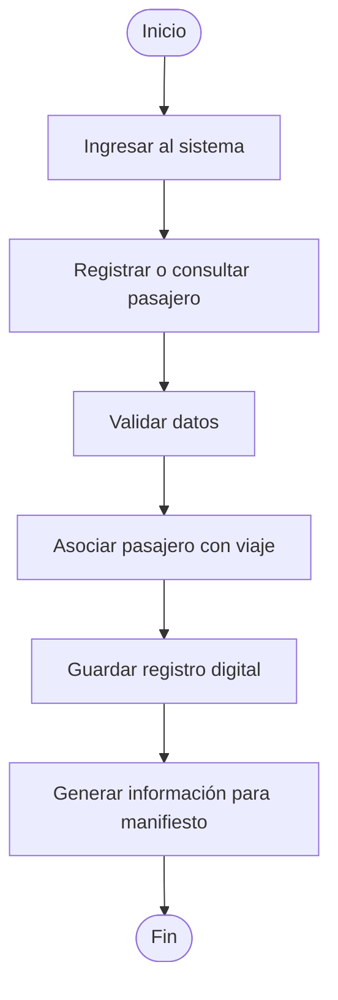

## 5.4. Proceso propuesto de despacho de vehículos

**Objetivo:** mejorar la coordinación de las salidas y la disponibilidad de los vehículos.

**Funcionamiento propuesto:**

1. El despachador ingresa al módulo administrativo.
2. Consulta los vehículos disponibles.
3. Verifica la cantidad de pasajeros registrados.
4. Asigna el vehículo y el conductor.
5. Confirma los pasajeros asociados al viaje.
6. El sistema registra el despacho.
7. Se genera el manifiesto correspondiente.
8. Se habilita el viaje para el control de abordaje.
9. El vehículo inicia el recorrido.

**Beneficios esperados:**

- Mayor organización de las salidas.
- Información centralizada.
- Consulta de disponibilidad.
- Mejor coordinación entre despachadores y conductores.
- Reducción de inconsistencias en los registros.

### Diagrama de despacho TO-BE

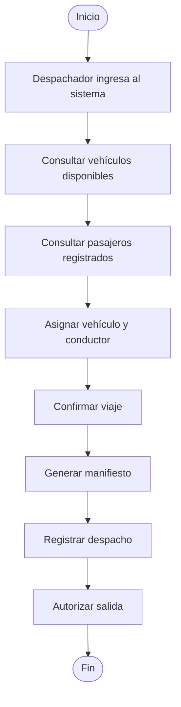

## 5.5. Proceso propuesto de recaudo

**Objetivo:** garantizar la trazabilidad de los ingresos generados durante la operación.

**Funcionamiento propuesto:**

1. El pasajero adquiere el tiquete.
2. El sistema registra el valor de la operación.
3. Se asocia el pago con el pasajero y el viaje.
4. Si se permite el abordaje de pasajeros durante la ruta, el ayudante registra la operación en la interfaz móvil.
5. Se registra el valor recibido y el medio de pago.
6. La información se sincroniza con el sistema central cuando existe conectividad.
7. La administración consulta los movimientos.
8. Se generan reportes para comparar los ingresos registrados con el dinero entregado.

**Beneficios esperados:**

- Mayor trazabilidad.
- Reducción de diferencias en los reportes.
- Control de ingresos.
- Identificación de operaciones pendientes.
- Información disponible para la administración.

### Diagrama de recaudo TO-BE

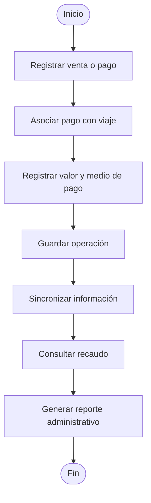

## 5.6. Proceso propuesto de control de pasajeros en ruta

**Objetivo:** verificar digitalmente los pasajeros que abordan el vehículo.

**Funcionamiento propuesto:**

1. El vehículo recibe la autorización de salida.
2. El conductor o ayudante ingresa a la aplicación.
3. Consulta el viaje asignado.
4. Escanea el código QR del pasajero.
5. El sistema verifica la validez del tiquete.
6. Se registra el abordaje.
7. Los pasajeros adicionales se registran mediante el procedimiento autorizado.
8. La información se sincroniza con la plataforma central.
9. La administración puede consultar los registros actualizados.

**Beneficios esperados:**

- Verificación de tiquetes.
- Control de pasajeros.
- Actualización de los registros de abordaje.
- Mayor trazabilidad durante el recorrido.

### Diagrama de control TO-BE

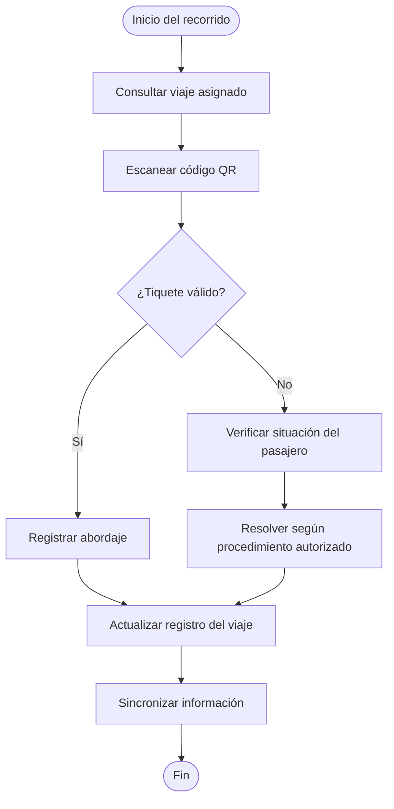

## 5.7. Comparación de los procesos AS-IS y TO-BE

| Proceso | AS-IS (actual) | TO-BE (propuesto) |
|---|---|---|
| Venta de tiquetes | Tiquetes físicos. | Tiquetes digitales con QR. |
| Registro de pasajeros | Formatos físicos. | Base de datos centralizada. |
| Despacho | Llamadas y coordinación informal. | Módulo de administración y despacho. |
| Recaudo | Manejo de efectivo y reportes manuales. | Registro digital y seguimiento de operaciones. |
| Control en ruta | Verificación informal. | Escaneo de QR y actualización de abordajes. |
| Información | Dispersa y desactualizada. | Información centralizada y consultable. |
| Manifiestos | Documentación física susceptible a inconsistencias. | Generación digital a partir de registros validados. |

## 5.8. Beneficios generales de la transformación

La transformación propuesta permitirá mejorar la coordinación entre las áreas de la cooperativa, facilitar el seguimiento de las operaciones y disminuir la dependencia de procesos manuales.

También proporcionará información organizada para evaluar la demanda, controlar los ingresos y mejorar la experiencia de los pasajeros.

Es importante aclarar que estos son beneficios esperados: deberán comprobarse mediante indicadores después de implementar y evaluar la solución.

---

# 6. ENTREVISTAS EMPRESARIALES

## 6.1. Realización de las entrevistas

Como parte del diagnóstico empresarial de Cootransoriente Tayrona, se realizaron tres entrevistas virtuales el 11 de noviembre de 2026. Las personas entrevistadas fueron el gerente, Martin Rodriguez; el conductor, Octavio Gutierrez; y el despachador, Edward Perez.

Las entrevistas tuvieron como propósito conocer el funcionamiento administrativo y operativo de la cooperativa, identificar las actividades que desarrolla el personal y reconocer las necesidades relacionadas con la venta de tiquetes, el registro de pasajeros, la organización de los despachos, el control de los recorridos y el manejo del recaudo.

Durante las conversaciones se abordaron preguntas relacionadas con las funciones de cada cargo, los procedimientos de trabajo, las dificultades que se presentan en la operación y las oportunidades de mejora mediante herramientas tecnológicas. La información recopilada se organizó en los apartados siguientes y forma parte del diagnóstico empresarial.

## 6.2. Entrevista 1: administrador o gerente

**Objetivo:** conocer la gestión administrativa, los procesos internos, las dificultades operativas y las necesidades de transformación digital de Cootransoriente Tayrona.

### Información general

| Campo | Información |
|---|---|
| Empresa | Cootransoriente Tayrona |
| Entrevistado | Martin Rodriguez |
| Cargo | Gerente |
| Entrevistador | Andrea Mendoza |
| Fecha | 11 de noviembre de 2026 |
| Modalidad | Virtual (llamada) |
| Duración | 17 minutos |

### Temas abordados durante la entrevista

Durante la entrevista se trataron los siguientes temas relacionados con la administración y el funcionamiento de la cooperativa:

1. Organización actual de la cooperativa.
2. Principales actividades administrativas y operativas.
3. Procedimiento de venta de tiquetes.
4. Registro de los datos de los pasajeros.
5. Organización y despacho de los vehículos.
6. Mecanismos utilizados para controlar el dinero recaudado.
7. Verificación de los ingresos frente a los pasajeros transportados.
8. Dificultades que se presentan durante las temporadas de alta demanda.
9. Manejo de los registros y manifiestos de pasajeros.
10. Almacenamiento y conservación de la información.
11. Consecuencias de los errores en los procesos manuales.
12. Beneficios esperados de la implementación de un sistema digital.

La entrevista permitió incorporar la perspectiva administrativa al diagnóstico y abordar los procesos que requieren coordinación entre las diferentes áreas de la cooperativa.

## 6.3. Entrevista 2: trabajador operativo – Conductor

**Objetivo:** conocer las actividades diarias del conductor, los procedimientos que utiliza durante los recorridos y las dificultades que se presentan en el control de pasajeros, los pagos y la comunicación con el personal de despacho.

### Información general

| Campo | Información |
|---|---|
| Empresa | Cootransoriente Tayrona |
| Entrevistado | Octavio Gutierrez |
| Cargo | Conductor |
| Entrevistador | Andrea Mendoza |
| Fecha | 11 de noviembre de 2026 |
| Modalidad | Virtual (llamada) |
| Duración | 15 minutos |

### Temas abordados durante la entrevista

1. Funciones principales del conductor.
2. Actividades realizadas al comenzar la jornada laboral.
3. Atención y registro de pasajeros.
4. Documentos y formatos utilizados diariamente.
5. Dificultades durante la prestación del servicio.
6. Comunicación con los demás trabajadores.
7. Consulta de la disponibilidad de los vehículos.
8. Control de los pasajeros que abordan durante el recorrido.
9. Registro y entrega de los pagos recibidos.
10. Dificultades cuando aumenta la cantidad de pasajeros.
11. Utilidad de un sistema digital para facilitar las actividades.
12. Características que debería tener una herramienta tecnológica de apoyo.

## 6.4. Acta de entrevista: Conductor

**Tipo:** Entrevista operativa – Conductor.

| Campo | Registro |
|---|---|
| Nombre de la organización | Cootransoriente Tayrona |
| Nombre del entrevistado | Octavio Gutierrez |
| Cargo | Conductor |
| Fecha | 11 de noviembre de 2026 |
| Modalidad | Virtual (llamada) |
| Entrevistador | Andrea Mendoza |
| Objetivo | Conocer las actividades que realiza el conductor durante la prestación del servicio de transporte intermunicipal, identificando los procedimientos que utiliza durante los recorridos, el control de pasajeros, el registro de pagos, la comunicación con el personal de despacho y el manejo de la información del viaje. |

### Desarrollo de la entrevista

- **Descripción de las funciones del trabajador:** El conductor se encarga de realizar los recorridos asignados, transportar a los pasajeros y cumplir con los horarios establecidos por la cooperativa.

- **Dificultades identificadas durante la operación:** Se identificaron dificultades relacionadas con el control de los pasajeros que abordan durante el recorrido, la comunicación con el personal de despacho y la actualización de la información del viaje.

- **Registro y recaudo:** Se abordó la importancia de llevar un control adecuado de los pagos recibidos, especialmente cuando los pasajeros abordan en diferentes puntos de la ruta.

- **Necesidades tecnológicas:** Se identificó la utilidad de contar con una herramienta que permita consultar los viajes asignados, registrar pasajeros, verificar los pagos y mantener la comunicación con el personal administrativo.

- **Recomendaciones para mejorar el servicio:** Se planteó la conveniencia de utilizar un sistema sencillo desde el celular que facilite el registro de pasajeros, el control de los pagos y la comunicación con el personal de despacho.

### Conclusiones de la entrevista

La entrevista realizada a Octavio Gutierrez permitió conocer las actividades que desarrolla el conductor y las situaciones que enfrenta durante la prestación del servicio. Se destacaron el control de los pasajeros durante los recorridos, el registro de los pagos recibidos y la comunicación con el personal de despacho.

Los temas tratados permitieron identificar oportunidades de mejora en los mecanismos utilizados para registrar pasajeros y controlar el recaudo, especialmente cuando las personas abordan en diferentes puntos de la ruta. También se reconoció la utilidad de una herramienta tecnológica sencilla para consultar los viajes asignados, registrar pasajeros y facilitar la comunicación con el personal administrativo.

**Firma del entrevistado:** _____Octavio Gutierrez_____________________

**Firma del entrevistador:** _____Andrea Mendoza______________________

## 6.5. Acta de entrevista: Despachador

**Tipo:** Entrevista operativa – Despachador.

| Campo | Registro |
|---|---|
| Nombre de la organización | Cootransoriente Tayrona |
| Nombre del entrevistado | Edward Perez |
| Cargo | Despachador |
| Fecha | 11 de noviembre de 2026 |
| Modalidad | Virtual (llamada) |
| Entrevistador | Andrea Mendoza |
| Objetivo | Conocer las actividades que realiza el despachador en la coordinación y organización de los servicios de transporte, los procedimientos para programar las salidas, asignar conductores, controlar horarios y mantener la comunicación con el personal operativo. |

### Desarrollo de la entrevista

- **Descripción de las funciones del trabajador:** El despachador se encarga de organizar y coordinar la salida de los vehículos, asignar los recorridos, comunicarse con los conductores y verificar que los viajes se realicen de acuerdo con la programación establecida.

- **Procedimientos utilizados diariamente:** Consulta la disponibilidad de los vehículos, organiza los horarios de salida, verifica la información de los pasajeros, asigna los conductores y coordina los despachos.

- **Dificultades durante la operación:** Se identificaron dificultades relacionadas con la coordinación de las salidas, el control de los horarios y la comunicación con los conductores, especialmente cuando aumenta la cantidad de pasajeros.

- **Registros y pagos:** Se abordó el manejo de la información de los pasajeros y los pagos, así como la importancia de contar con registros organizados que permitan verificar los tiquetes vendidos y controlar el dinero recaudado durante los recorridos.

- **Recomendaciones para mejorar el servicio:** Se planteó la conveniencia de implementar un sistema digital que permita organizar los despachos, consultar la disponibilidad de los vehículos, llevar un registro actualizado de los pasajeros y mejorar la comunicación con los conductores.

### Conclusiones de la entrevista

La entrevista realizada a Edward Perez permitió conocer la función del despachador en la coordinación y organización de los servicios de transporte. Se trataron sus responsabilidades en la programación de las salidas, la asignación de conductores, la consulta de disponibilidad de vehículos y la comunicación con el personal operativo.

Los temas abordados permitieron reconocer oportunidades de mejora en la coordinación de los horarios, el seguimiento de los viajes y la organización de los registros de pasajeros y pagos. Se destacó la utilidad de una herramienta digital que facilite la centralización de la información y la comunicación entre el área de despacho y los conductores.

**Firma del entrevistado:** _____Edward Perez________________________

**Firma del entrevistador:** _____Andrea Mendoza______________________

## 6.6. Síntesis de las entrevistas y datos recopilados

Las entrevistas realizadas al gerente, al conductor y al despachador permitieron abordar el funcionamiento de Cootransoriente Tayrona desde las perspectivas administrativa y operativa. En conjunto, las conversaciones trataron la organización de la cooperativa, la venta de tiquetes, el registro de pasajeros, la disponibilidad y asignación de vehículos, la coordinación de los despachos, el control durante los recorridos y el manejo de los pagos.

| Entrevistado | Cargo | Aspectos tratados en la entrevista |
|---|---|---|
| Martin Rodriguez | Gerente | Organización de la cooperativa, gestión administrativa, procesos operativos, venta de tiquetes, registro de pasajeros, despacho, recaudo, manifiestos y transformación digital. |
| Octavio Gutierrez | Conductor | Funciones durante los recorridos, atención y control de pasajeros, registro de pagos, comunicación con despacho y necesidades de herramientas móviles. |
| Edward Perez | Despachador | Organización de salidas, asignación de vehículos y conductores, control de horarios, disponibilidad, comunicación y organización de registros. |

### Datos cuantitativos recopilados

| Aspecto | Información recopilada |
|---|---:|
| Vehículos de la cooperativa | 52 vehículos |
| Trabajadores que cuentan con dispositivo | 52 trabajadores |
| Tope presupuestal mencionado para el proyecto | $300.000.000 COP |

Estos datos se incorporan como información recopilada durante las entrevistas y hacen parte de los elementos considerados en el diagnóstico empresarial.

---

# 7. OBSERVACIÓN DEL FUNCIONAMIENTO EMPRESARIAL

## 7.1. Objetivo

Establecer un instrumento que permita analizar cómo se desarrollan las actividades de venta, registro, despacho, recaudo y control de pasajeros en Cootransoriente Tayrona.

## 7.2. Aspectos que deben observarse

| Área | Aspecto por observar | Evidencia que se debe recopilar |
|---|---|---|
| Taquilla | Atención a los usuarios y venta de tiquetes mediante formatos físicos. | Descripción del procedimiento de venta y registro de tiquetes. |
| Registro | Forma en que se recopilan y almacenan los datos de los pasajeros. | Ejemplo de planilla de registro de pasajeros. |
| Despacho | Organización de los vehículos, asignación de conductores y coordinación de las salidas. | Descripción del procedimiento de despacho y programación de viajes. |
| Recaudo | Recepción, registro y control del dinero recibido por la venta de tiquetes. | Descripción del proceso de recaudo y formatos utilizados. |
| Operación | Control de pasajeros que abordan durante los recorridos y cumplimiento de las rutas. | Descripción del procedimiento de control de pasajeros. |
| Documentación | Elaboración, almacenamiento y conservación de manifiestos de pasajeros y otros documentos operativos. | Ejemplos de formatos documentales anonimizados. |
## 7.3. Lista de chequeo de observación

**Aclaración metodológica:** La lista se diligenció como una valoración preliminar a partir del contexto del caso y de la información recopilada en las entrevistas; no corresponde a una observación presencial directa. Por lo tanto, las marcas no deben interpretarse como resultados de una visita de campo.

| N.º | Criterio | Sí | No | No observado |
|---|---|---|---|---|
| 1 | La venta de tiquetes se realiza mediante formatos físicos. | [x] | [ ] | [ ] |
| 2 | El registro de pasajeros se realiza manualmente. | [x] | [ ] | [ ] |
| 3 | Se verifica la disponibilidad de los vehículos. | [x] | [ ] | [ ] |
| 4 | Existe un procedimiento definido para el despacho. | [ ] | [x] | [ ] |
| 5 | Se registran los pagos realizados por los pasajeros. | [x] | [ ] | [ ] |
| 6 | Se verifica el dinero recibido por los trabajadores. | [ ] | [x] | [ ] |
| 7 | Se controla la cantidad de pasajeros durante el recorrido. | [ ] | [x] | [ ] |
| 8 | Se utilizan manifiestos de pasajeros. | [x] | [ ] | [ ] |
| 9 | Existe comunicación entre conductores y despachadores. | [x] | [ ] | [ ] |
| 10 | La información operativa se encuentra centralizada. | [ ] | [x] | [ ] |

---

# 8. INDICADORES EMPRESARIALES Y LÍNEA BASE

## 8.1. Objetivo

Establecer indicadores que permitan evaluar el rendimiento de los procesos actuales y comparar sus resultados con los obtenidos después de implementar la transformación digital.

La línea base corresponde a los valores iniciales medidos antes de implementar la solución.

**Importante:** no se dispone de registros operativos institucionales que permitan verificar una línea base completa. Por tanto, los valores medidos quedan pendientes de medición. Las cifras de 4,5 minutos para el despacho y de 15 % a 18 % de evasión se incluyen únicamente como estimaciones preliminares del equipo, no como mediciones ni resultados verificados.

## 8.2. Indicadores propuestos

| Indicador | Fórmula | Unidad |
|---|---|---|
| Tiempo promedio de venta | Tiempo total de atención / Número de ventas | Minutos |
| Tiempo de registro | Tiempo total de registro / Número de pasajeros registrados | Minutos |
| Porcentaje de errores en registros | (Registros con errores / Total de registros) × 100 | Porcentaje |
| Cumplimiento de despachos | (Despachos realizados a tiempo / Total de despachos programados) × 100 | Porcentaje |
| Diferencia de recaudo | Ingresos verificados − Ingresos reportados | Pesos |
| Porcentaje de diferencias de recaudo | (Valor absoluto de diferencias / Ingresos verificados) × 100 | Porcentaje |
| Ocupación vehicular | (Pasajeros transportados / Capacidad autorizada) × 100 | Porcentaje |
| Exactitud del manifiesto | (Pasajeros correctamente registrados / Total de pasajeros transportados) × 100 | Porcentaje |

## 8.3. Tabla de línea base

| Indicador | Valor inicial | Meta propuesta |
|---|---|---|
| Tiempo promedio de despacho | 4,5 minutos (estimación del equipo, no medida) | Reducirlo y establecer una línea base mediante medición. |
| Evasión estimada | Entre 15 % y 18 % (estimación del equipo, no medida) | Reducirla mediante controles y registros verificables. |
| Tiempo promedio de venta | Pendiente de medición | Reducirlo un 30 %. |
| Tiempo promedio de registro | Pendiente de medición | Reducirlo un 30 %. |
| Errores en registros | Pendiente de medición | Reducirlos un 50 %. |
| Cumplimiento de despachos | Pendiente de medición | Alcanzar al menos 95 %. |
| Diferencias de recaudo | Pendiente de medición | Reducirlas progresivamente. |
| Ocupación vehicular | Pendiente de medición | Mejorar su seguimiento. |
| Exactitud del manifiesto | Pendiente de medición | Alcanzar el 100 % de concordancia documental. |

**Nota sobre las cifras:** Los valores de 4,5 minutos y de 15 % a 18 % son estimaciones preliminares del equipo y no provienen de una medición documentada. **Persona que realizó la estimación, fuente o método utilizado y fecha de cálculo: [PENDIENTE DE COMPLETAR].** No deben presentarse como indicadores verificados. Las demás metas son objetivos de diseño propuestos para el proyecto académico, no resultados comprobados ni compromisos aprobados por la cooperativa.

## 8.4. Método para recopilar los datos

Para calcular los indicadores se propone:

1. Seleccionar una muestra de operaciones de venta.
2. Medir el tiempo empleado en cada atención.
3. Revisar una muestra de registros de pasajeros.
4. Comparar los manifiestos con los registros de abordaje.
5. Revisar los reportes de recaudo.
6. Registrar los horarios programados y reales de despacho.
7. Consolidar los resultados en una hoja de cálculo.
8. Calcular los indicadores mediante las fórmulas establecidas.

Se recomienda utilizar registros de un periodo representativo, incluyendo días de demanda normal y días de mayor movimiento.

---

# 9. PROBLEMA EMPRESARIAL PRIORIZADO

## 9.1. Problema principal

Después de analizar los procesos descritos en el escenario empresarial, se prioriza como problema principal la **falta de integración y trazabilidad de la información operativa y financiera en el servicio de transporte intermunicipal de Cootransoriente Tayrona**.

Esta problemática afecta directamente la venta de tiquetes, el registro de pasajeros, el despacho de vehículos, el recaudo del dinero y el control de pasajeros durante los recorridos.

## 9.2. Justificación de la priorización

Se considera prioritario porque afecta diferentes áreas de la organización y genera consecuencias tanto administrativas como económicas.

Entre sus principales consecuencias se encuentran:

- Dificultades para verificar los ingresos reales.
- Falta de información actualizada sobre los pasajeros.
- Posibilidad de inconsistencias en los manifiestos.
- Demoras durante la atención en taquilla.
- Dificultades para coordinar los despachos.
- Limitaciones para tomar decisiones basadas en información confiable.

## 9.3. Árbol del problema

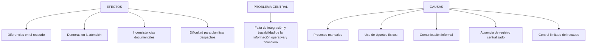

## 9.4. Objetivo de mejora

Implementar un modelo de gestión operativa basado en información digital centralizada que permita mejorar la venta de tiquetes, el registro de pasajeros, el despacho de vehículos y el control de los ingresos, fortaleciendo la eficiencia administrativa y la calidad del servicio.

---

# 10. ANÁLISIS DE BRECHAS DE NEGOCIO

Este análisis permite identificar las diferencias entre la situación actual y la situación que se desea alcanzar.

## 10.1. Comparación de brechas

| Área | Situación AS-IS | Situación TO-BE | Brecha identificada |
|---|---|---|---|
| Venta | Tiquetes físicos. | Tiquetes digitales con QR. | Falta de digitalización. |
| Registro | Formatos manuales. | Registro centralizado. | Falta de integración de datos. |
| Despacho | Coordinación informal. | Módulo digital de despacho. | Falta de información actualizada. |
| Recaudo | Control principalmente manual. | Seguimiento digital de pagos. | Falta de trazabilidad financiera. |
| Pasajeros | Verificación informal. | Validación mediante QR. | Falta de control automatizado. |
| Manifiestos | Documentos físicos. | Generación digital. | Riesgo de inconsistencias. |
| Información | Registros dispersos. | Base de datos centralizada. | Ausencia de una fuente común de información. |

## 10.2. Acciones necesarias para cerrar las brechas

1. Digitalizar el proceso de venta.
2. Establecer un registro único de pasajeros.
3. Implementar un módulo de despacho.
4. Integrar el registro de pagos.
5. Incorporar lectura de códigos QR.
6. Centralizar los datos de los viajes.
7. Definir procedimientos para actualizar los manifiestos.
8. Establecer indicadores para medir los resultados.

## 10.3. Resultados esperados

Con la implementación de las acciones propuestas se espera:

- Mejorar la organización de los procesos.
- Reducir los tiempos de atención.
- Disminuir los errores de registro.
- Mejorar la trazabilidad del recaudo.
- Facilitar la consulta de la disponibilidad de los vehículos.
- Mantener información más actualizada de los pasajeros.
- Fortalecer el control documental.
- Mejorar la disponibilidad de información para la toma de decisiones.

---

# 11. CONCLUSIONES DEL DIAGNÓSTICO EMPRESARIAL

El análisis de Cootransoriente Tayrona permite identificar que los principales problemas del escenario empresarial se encuentran relacionados con la dependencia de procesos manuales, la dispersión de la información y la falta de mecanismos adecuados para controlar las operaciones durante los recorridos.

Los procesos de venta, registro de pasajeros, despacho, recaudo y control en ruta están relacionados entre sí. Por esta razón, las dificultades que se presentan en una actividad pueden afectar el funcionamiento de las demás.

El modelo Canvas permitió identificar los elementos principales del negocio, sus actividades, recursos, clientes y fuentes de ingresos. Por su parte, los diagramas AS-IS facilitaron la representación de los procedimientos actuales y permitieron establecer las oportunidades de mejora mediante los diagramas TO-BE.

La propuesta de transformación digital busca centralizar la información, mejorar la trazabilidad de los ingresos, facilitar el registro de pasajeros y optimizar la coordinación de los vehículos.

El análisis de brechas permitió identificar los cambios que deben realizarse para pasar de un modelo basado en procedimientos manuales a uno apoyado en herramientas digitales.

Finalmente, se concluye que la transformación de los procesos empresariales debe acompañarse de indicadores que permitan medir los resultados, verificar las mejoras y establecer decisiones administrativas fundamentadas en información confiable.

---

# 12. REFERENCIAS BIBLIOGRÁFICAS

Dumas, M., La Rosa, M., Mendling, J., & Reijers, H. A. (2018). *Fundamentals of business process management* (2nd ed.). Springer. https://doi.org/10.1007/978-3-662-56509-4

Object Management Group. (2014). *Business Process Model and Notation (BPMN), Version 2.0.2*. https://www.omg.org/spec/BPMN/2.0.2/

Osterwalder, A., & Pigneur, Y. (2010). *Business model generation: A handbook for visionaries, game changers, and challengers*. John Wiley & Sons.

---

**FIN DE LOS ENTREGABLES DE ANDREA**

**Responsable:** Andrea  
**Área:** Arquitectura de negocio y diagnóstico empresarial  
**Proyecto:** Cootransoriente Tayrona

